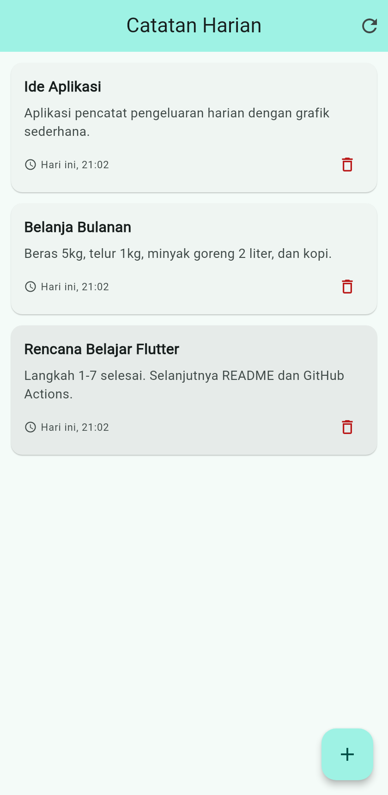
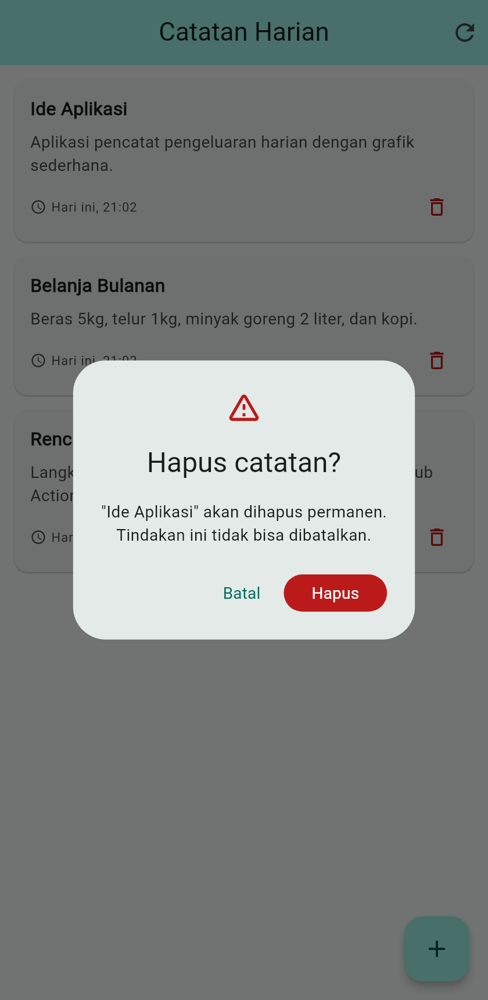
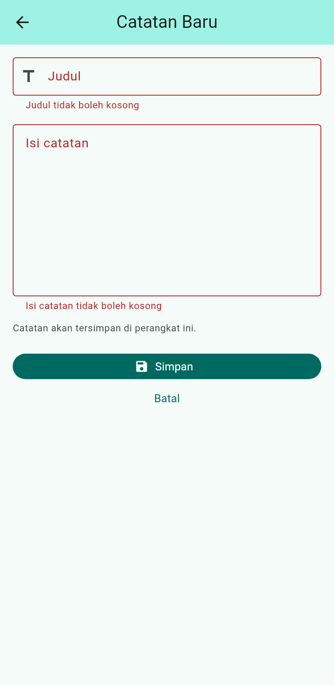

# Catatan Harian

[](https://github.com/Athakasi/catatan-harian/actions/workflows/ci.yml)
[](https://github.com/Athakasi/catatan-harian/actions/workflows/deploy.yml)
[](https://flutter.dev)
[](README.md#lisensi)

Aplikasi catatan sederhana yang berjalan di **Android** dan **Web** dari satu basis kode Flutter.
Dibuat sebagai proyek belajar Dart/Flutter untuk developer yang sudah mengenal PHP, JavaScript, dan OOP.

<p align="center">
  <a href="https://athakasi.github.io/catatan-harian/">
    
  </a>
</p>

<p align="center">
  
  
  
</p>

> **Coba langsung tanpa memasang apa pun:**
> **[athakasi.github.io/catatan-harian](https://athakasi.github.io/catatan-harian/)**
>
> Data disimpan di `localStorage` browser Anda — tidak ada server, tidak ada akun.

## Fitur

- **Tambah, lihat, sunting, hapus** catatan (CRUD lengkap)
- **Validasi form** — judul dan isi wajib diisi, judul maksimal 100 karakter
- **Konfirmasi sebelum menghapus** — mencegah data hilang karena salah sentuh
- **Penyimpanan lokal otomatis** — data tetap ada setelah aplikasi ditutup
- **Urut berdasarkan terakhir diubah** — catatan terbaru selalu di atas
- **Tampilan responsif** — satu kode untuk layar HP dan browser desktop
- **Format tanggal ramah** — "Hari ini, 21:02", "Kemarin, 18:46"

## Teknologi

| Bagian | Dipakai |
|---|---|
| Framework | Flutter 3.50 / Dart 3.14 |
| UI | Material 3 (`material_ui`) |
| Penyimpanan | `shared_preferences` 2.5.6 |
| Pengujian | `flutter_test` — 38 test |

## Cara Menjalankan

```bash
# 1. Ambil dependency
flutter pub get

# 2. Jalankan di Chrome
flutter run -d chrome

# 3. Atau jalankan di perangkat Android yang terhubung
flutter run -d android
```

## Struktur Proyek

```
lib/
├── main.dart                     # Titik masuk aplikasi
├── app.dart                      # Konfigurasi tema & halaman awal
├── models/
│   └── note.dart                 # Model data + konversi JSON
├── services/
│   └── note_storage.dart         # Baca/tulis penyimpanan lokal
├── screens/
│   ├── note_list_screen.dart     # Halaman daftar catatan
│   └── note_form_screen.dart     # Halaman tambah & sunting
├── widgets/
│   ├── note_card.dart            # Kartu catatan
│   └── dialog_konfirmasi.dart    # Dialog konfirmasi yang bisa dipakai ulang
└── utils/
    └── tanggal.dart              # Format tanggal Bahasa Indonesia

test/
├── models/note_test.dart           # 6 test — model & JSON
├── services/note_storage_test.dart # 8 test — penyimpanan
├── screens/note_form_test.dart     # 8 test — form & validasi
├── screens/hapus_catatan_test.dart # 7 test — hapus & konfirmasi
└── widget_test.dart                # 9 test — halaman daftar & alur navigasi
```

Pemisahan ini mengikuti pola yang sama seperti MVC: **model** menyimpan bentuk data,
**service** mengurus penyimpanan, **screen** mengurus tampilan. Halaman tidak pernah
menyentuh penyimpanan secara langsung, sehingga mengganti `shared_preferences` dengan
database atau API server nanti hanya perlu mengubah satu file.

## Menjalankan Pengujian

```bash
# Di Dart VM (cepat, untuk pengembangan sehari-hari)
flutter test

# Di browser sungguhan (penting untuk aplikasi web)
flutter test --platform chrome

# Cek gaya kode & error statis
flutter analyze
```

### Kenapa perlu diuji di dua tempat?

Karena Dart berjalan di atas *runtime* yang berbeda. Saat pengembangan proyek ini,
sebuah bug nyata ditemukan **hanya** lewat `flutter test --platform chrome`:
di browser, `DateTime.now()` hanya presisi milidetik (sama seperti `Date.now()` di
JavaScript), sedangkan di Dart VM presisinya mikrodetik. Akibatnya dua catatan yang
dibuat dalam milidetik yang sama mendapat **id identik**, sehingga menghapus satu
catatan ikut menghapus yang lain. Perbaikannya ada di `Note.baru()` dengan
menambahkan penghitung unik, dan dikunci oleh test regresi.

## Deploy Otomatis

Aplikasi web ini diterbitkan otomatis ke **GitHub Pages** setiap kali ada push ke
`main`. Tidak ada langkah manual: workflow [`.github/workflows/deploy.yml`](.github/workflows/deploy.yml)
membangun aplikasi lalu menerbitkannya.

Dua hal yang mudah terlewat saat mendeploy Flutter ke GitHub Pages, dan sudah
ditangani di workflow:

1. **`--base-href /catatan-harian/`** — GitHub Pages menyajikan repo di sub-folder,
   bukan di akar domain. Tanpa ini, browser mencari `main.dart.js` di
   `username.github.io/` dan mendapat 404, sehingga halaman tampil putih kosong.
2. **File `.nojekyll`** — GitHub menjalankan Jekyll secara default, dan Jekyll
   membuang file/folder yang namanya diawali garis bawah.

Kalau nanti repository ini diganti nama, `--base-href` di `deploy.yml` **harus**
ikut diubah.

## Membangun untuk Rilis

### Web

```bash
flutter build web --release --base-href /catatan-harian/
# Hasil: build/web/
```

Tanpa `--base-href`, build hanya cocok untuk disajikan dari akar domain
(misalnya `flutter run -d chrome` saat pengembangan).

> **Catatan ukuran:** hasil build web sekitar 40 MB karena Flutter menyertakan mesin
> render CanvasKit secara lokal. Ini normal. Ukuran yang benar-benar diunduh pengguna
> jauh lebih kecil, karena browser hanya mengambil bagian yang dibutuhkan.

### Android

```bash
# APK terpisah per arsitektur CPU — jauh lebih kecil
flutter build apk --release --split-per-abi

# Hasil:
#   app-armeabi-v7a-release.apk  (~15 MB) — HP Android lama
#   app-arm64-v8a-release.apk    (~17 MB) — mayoritas HP modern
#   app-x86_64-release.apk       (~19 MB) — emulator
```

Untuk mengunggah ke Play Store, gunakan App Bundle:

```bash
flutter build appbundle --release
```

## Catatan Teknis

**Penyimpanan.** `shared_preferences` menyimpan data sebagai pasangan kunci-nilai:
`localStorage` di web, file preferensi di Android. Cocok untuk data kecil seperti
catatan teks. Untuk ribuan catatan atau data sensitif, gunakan database (SQLite via
`sqflite`) atau penyimpanan terenkripsi.

**Penanganan data rusak.** Kalau isi penyimpanan tidak bisa dibaca (misalnya diubah
manual lewat DevTools browser), aplikasi tidak *crash*. `NoteStorage.muatSemua()`
mengembalikan daftar kosong dan halaman menampilkan pesan error yang bisa dimengerti
pengguna, bukan layar putih.

**Immutability.** Semua properti `Note` bertanda `final`. Menyunting catatan berarti
membuat objek baru lewat `copyWith()`, bukan mengubah objek lama. Ini membuat
perubahan data lebih mudah dilacak saat ada bug.

## Lisensi

Proyek ini bebas dipakai untuk belajar.
